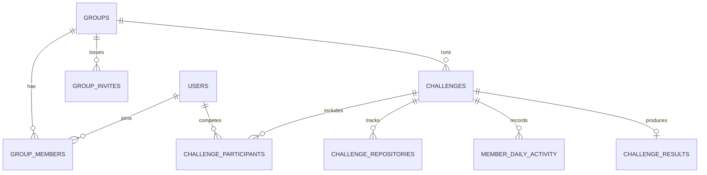
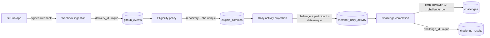

<div align="center">

# DevRats API ⚙️

**Backend for DevRats — private consistency challenges for developers, with automatic GitHub commit verification, groups, rankings, streaks, and atomic winner resolution.**

[](https://github.com/felipevenas/api-dev-rats/actions/workflows/ci.yml)
[](https://openjdk.org/)
[](https://spring.io/projects/spring-boot)
[](https://www.postgresql.org/)
[](https://flywaydb.org/)
[](https://maven.apache.org/)
[](https://junit.org/)
[](LICENSE)

<br />

<p align="center">
  <a href="#overview"><b>Overview</b></a> •
  <a href="#architecture"><b>Architecture</b></a> •
  <a href="#quick-start"><b>Quick Start</b></a> •
  <a href="#configuration"><b>Configuration</b></a> •
  <a href="#github-app"><b>GitHub App</b></a> •
  <a href="#api-surface"><b>API</b></a> •
  <a href="#testing"><b>Testing</b></a> •
  <a href="#known-limitations-mvp-trade-offs"><b>Limitations</b></a> •
  <a href="#governance"><b>Governance</b></a>
</p>

</div>

---

> **Frontend repository:** [felipevenas/webapp-dev-rats](https://github.com/felipevenas/webapp-dev-rats) ·
> **Live product:** [devrats.app](https://devrats.app) ·
> **Public API:** [api.devrats.app](https://api.devrats.app)

## Overview

DevRats rewards **showing up**, not finishing a course. A group creates a private challenge with a target number of valid days. The API watches the participants' GitHub repositories, verifies eligible commits, projects them into daily activity, and declares a winner when the target is reached.

This repository contains **only the backend**. The React frontend lives in [`webapp-dev-rats`](https://github.com/felipevenas/webapp-dev-rats).

### What this service owns

| Area | Responsibility |
|---|---|
| Identity | Registration, login, rotating refresh tokens, profile, LGPD export/deletion |
| GitHub integration | GitHub App OAuth, installation sync, repository catalog, signed webhooks |
| Challenges | Group lifecycle, invitation links, challenge draft/start/cancel, repository binding |
| Verification | Commit eligibility policy, timezone-aware day projection, idempotent reconciliation |
| Results | Leaderboard, streaks, activity calendar, atomic winner selection and audit trail |
| Social | Friendships, presence, notifications, group and private real-time chat |

### Core capabilities

- Java 25 and Spring Boot 4.1 with Web MVC, Security, Data JPA, Validation, Actuator, and WebSocket/STOMP.
- PostgreSQL 17 with Flyway-owned schema and Hibernate `validate` mode.
- JWT HS256 access tokens plus rotating refresh tokens in an `HttpOnly`, `SameSite=Strict` cookie.
- GitHub App integration with HMAC-verified webhooks and encrypted token storage (AES-256-GCM).
- Idempotency enforced by database constraints across webhooks, commits, and daily activity.
- RFC 9457 (`application/problem+json`) error responses with `code`, `detail`, and `traceId`.
- Caffeine, Bucket4j rate limiting, springdoc OpenAPI, Micrometer, and Prometheus metrics.
- JUnit 5, AssertJ, Mockito, Testcontainers, WireMock, ArchUnit, and JaCoCo.

## Architecture

The codebase follows a conventional layered architecture. Controllers translate HTTP; services own use cases and transactions; repositories own persistence.

```text
src/main/java/com/devrats/
├── config/            security, properties, cache, OpenAPI, WebSocket configuration
├── controllers/       HTTP endpoints and global error handling
├── dto/               requests, responses, pagination
├── entities/          JPA entities
├── enums/             domain states and types
├── exceptions/        exceptions and error codes
├── repositories/      Spring Data JPA
├── security/          trace and rate-limit filters, security error writer
├── services/          use-case contracts
├── services/impl/     transactional implementations
├── services/github/   GitHub App client and authentication
├── services/activity/ eligibility, webhook processing, reconciliation
├── services/chat/     attachment policy, events, STOMP publishing
└── utils/             pure helpers and security utilities
```

Naming, comments, and helper conventions are documented in [`docs/CONVENTIONS.md`](docs/CONVENTIONS.md).

### Domain model: groups and challenges

**Groups** and **challenges** are intentionally separate entities:

- A **group** owns identity, membership, invitations, and the long-lived social context. It survives multiple challenge cycles.
- A **challenge** owns the current modality, target, timezone, window, status, repositories, progress, and result.

This separation preserves history: when a challenge completes, the group can start a new one without rewriting or deleting the previous result. The schema also keeps `challenge_participants`, `member_daily_activity`, and `challenge_results` tied to a specific challenge, so every cycle remains auditable.



### Request and verification flow



### Technical decisions

#### 1. At most one open challenge per group

A partial unique index guarantees the invariant at the database level:

```sql
CREATE UNIQUE INDEX uq_challenges_group_open
    ON challenges (group_id)
    WHERE status IN ('DRAFT', 'ACTIVE');
```

This prevents two concurrent requests from creating a second open challenge for the same group. Older challenges remain in `COMPLETED`, `CANCELLED`, or `EXPIRED` state and keep their full history.

#### 2. Atomic victory with a pessimistic lock

Winner resolution is serialized per challenge in [`ChallengeCompletionServiceImpl`](src/main/java/com/devrats/services/impl/ChallengeCompletionServiceImpl.java):

1. `ChallengeRepository.findByIdForUpdate` uses `@Lock(LockModeType.PESSIMISTIC_WRITE)`, which emits `SELECT ... FOR UPDATE` on PostgreSQL.
2. The service re-checks that the challenge is still `ACTIVE` and has no result.
3. It loads every participant who reached the target, orders candidates by achievement time, join time, and participant ID, and records exactly one winner.
4. `challenge_results.challenge_id` has a unique constraint (`uq_challenge_results_challenge`), so even a logic bug cannot persist two winners for the same challenge.

The lock is held only for the local transaction — never during an outbound GitHub HTTP call.

#### 3. Idempotency in three layers

Idempotency is enforced by **database constraints**, not by `if (exists)` checks. Each layer protects a different kind of duplicate delivery:

| Layer | Unique key | Protects against | Behavior on duplicate |
|---|---|---|---|
| Webhook delivery | `github_events.delivery_id` | GitHub retries the same event (`X-GitHub-Delivery`) | Event is stored once; the replay is ignored |
| Observed commit | `eligible_commits (github_repository_id, commit_sha)` | The same commit arriving via webhook **and** reconciliation | Commit metadata is written once |
| Daily activity | `member_daily_activity (challenge_id, participant_id, activity_date)` | Multiple eligible commits on the same local day | Existing row increments `valid_commit_count`; valid days do **not** double-count |

#### 4. Challenge timezone is fixed

Commit timestamps are stored in UTC (`TIMESTAMPTZ`). Each challenge carries a fixed IANA timezone, and the API converts `committed_at` to that zone before deriving the activity date. A participant cannot change the challenge timezone mid-cycle to gain an extra day.

#### 5. Strict commit eligibility

- Authorship is verified by the **numeric GitHub user ID**, never by commit name or e-mail.
- Bots, empty commits, and merge commits do not count.
- Forks do not count by default (`allow_forks=false`).
- Commits older than 48 hours (configurable via `APP_CHALLENGES_MAX_COMMIT_AGE`) are rejected.
- `SELECTED_REPOSITORIES` requires the repository to be explicitly linked to the challenge (maximum of 3).
- `OWN_REPOSITORIES` requires the repository to belong to the participant's personal account.
- Missed events are recovered by a periodic, idempotent reconciliation job.

#### 6. Secrets at rest

GitHub tokens are encrypted with **AES-256-GCM** using `TOKEN_ENCRYPTION_KEY` and a key version (`TOKEN_ENCRYPTION_KEY_ID`). Tokens are never returned to clients, logged, or included in error responses. Refresh tokens are stored as hashes and rotated on every use.

## Quick Start

### Prerequisites

- **JDK 25** (Temurin recommended)
- **Docker Desktop** (PostgreSQL locally and Testcontainers for integration tests)
- **Git**
- **Maven Wrapper** (already committed)

Installing JDK 25 on Windows:

```powershell
winget install --id EclipseAdoptium.Temurin.25.JDK --exact
```

### 1. Clone and prepare the environment

```powershell
git clone https://github.com/felipevenas/api-dev-rats.git
cd api-dev-rats
Copy-Item .env.example .env
```

`.env` contains development placeholders only. Never commit real secrets.

### 2. Start PostgreSQL

```powershell
docker compose up -d postgres
```

PostgreSQL is exposed on `localhost:55432` to avoid conflicts with local installations.

### 3. Run the API with the `local` profile

The `local` profile is **mandatory**. Without `SPRING_PROFILES_ACTIVE=local`, the application has no datasource or development secrets and will not boot. This fail-fast behavior prevents production from accidentally starting with development defaults.

```powershell
$env:SPRING_PROFILES_ACTIVE = 'local'
.\mvnw.cmd spring-boot:run
```

Or use the wrapper script, which also resolves the JDK path:

```powershell
.\run-local.ps1
```

On macOS/Linux:

```bash
export SPRING_PROFILES_ACTIVE=local
./mvnw spring-boot:run
```

The API starts at `http://localhost:8080`.

When running the companion frontend on `:5174`, also set:

```powershell
$env:APP_FRONTEND_URL = 'http://localhost:5174'
$env:APP_CORS_ALLOWED_ORIGINS = 'http://localhost:5173,http://localhost:5174'
```

The frontend origin must be present in both variables for GitHub OAuth redirects and refresh/logout requests to work.

| Endpoint | URL |
|---|---|
| Health | `GET /actuator/health` |
| OpenAPI JSON | `GET /v3/api-docs` |
| Swagger UI | `GET /swagger-ui.html` |
| Metrics | `GET /actuator/prometheus` |

### 4. Build and test

```powershell
.\mvnw.cmd verify
```

Integration tests use Testcontainers, so Docker must be running. The coverage report is generated at `target/site/jacoco/index.html`.

### 5. Run the full Docker stack (optional)

```powershell
docker compose --profile full up --build
```

The `full` profile starts PostgreSQL plus the API container.

## Configuration

Spring Boot reads `.env` through `spring.config.import=optional:file:.env[.properties]`. Values below mirror [`.env.example`](.env.example); replace every example secret before using a shared environment.

### Runtime and profiles

| Variable | Required | Default / example | Description |
|---|---|---|---|
| `SPRING_PROFILES_ACTIVE` | **Yes** | `local` | Activates `application-local.properties` or `application-prod.properties`. The app refuses to boot without a usable profile. |
| `JAVA_HOME` | No | JDK 25 path | Used by `run-local.ps1`; Maven can also resolve Java from `PATH`. |
| `AUTH_COOKIE_SECURE` | Prod | `false` (local) / `true` (prod) | Adds the `Secure` flag to the refresh cookie. Must be `true` behind HTTPS. |
| `AUTH_EXPOSE_RESET_TOKEN` | Local only | `true` (local) / `false` (prod) | Returns the password-reset token in the API response. **Never enable in production.** |
| `SPRINGDOC_ENABLED` | No | `false` (prod) | Enables OpenAPI/Swagger in the `prod` profile. |
| `JWT_AUDIENCE` | No | `devrats-web` | Expected JWT audience. |

### PostgreSQL

| Variable | Required | Default / example | Description |
|---|---|---|---|
| `DB_URL` | **Yes** | `jdbc:postgresql://localhost:55432/devstreak` | JDBC connection string. |
| `DB_USER` | **Yes** | `devstreak` | Database user. |
| `DB_PASS` | **Yes** | `devstreak` | Database password. |

Flyway runs automatically on startup. Hibernate only validates the schema; migrations are the source of truth.

### JWT

| Variable | Required | Default / example | Description |
|---|---|---|---|
| `JWT_SECRET` | **Yes** | base64-encoded 32-byte example | HMAC key for access tokens. Generate with `openssl rand -base64 32`. |
| `JWT_ISSUER` | No | `devrats-api` | JWT `iss` claim. |
| `JWT_ACCESS_TTL` | No | `PT15M` | Access-token lifetime (ISO-8601 duration). |
| `JWT_REFRESH_TTL` | No | `P30D` | Refresh-token lifetime. |

### Token encryption (AES-256-GCM)

| Variable | Required | Default / example | Description |
|---|---|---|---|
| `TOKEN_ENCRYPTION_KEY` | **Yes** | base64-encoded 32-byte example | Encrypts GitHub access/refresh tokens at rest. Generate with `openssl rand -base64 32`. |
| `TOKEN_ENCRYPTION_KEY_ID` | No | `1` | Key version recorded with each ciphertext to support rotation. |

### GitHub App

| Variable | Required | Default / example | Description |
|---|---|---|---|
| `GITHUB_APP_ID` | **Yes** for GitHub | — | Numeric GitHub App ID. |
| `GITHUB_CLIENT_ID` | **Yes** for GitHub | — | OAuth client ID of the GitHub App. |
| `GITHUB_CLIENT_SECRET` | **Yes** for GitHub | — | OAuth client secret. |
| `GITHUB_PRIVATE_KEY` | **Yes** for GitHub | — | PEM private key (PKCS#1/PKCS#8), or PKCS#8 base64. |
| `GITHUB_WEBHOOK_SECRET` | **Yes** for webhooks | `dev-webhook-secret` (local) | Shared secret used to validate `X-Hub-Signature-256`. |
| `GITHUB_APP_SLUG` | No | `devrats` | Slug used in the installation URL. |
| `GITHUB_CALLBACK_URL` | No | `http://localhost:8080/api/v1/integrations/github/callback` | OAuth callback registered in the GitHub App. |
| `GITHUB_SETUP_URL` | No | `http://localhost:8080/api/v1/integrations/github/setup` | Setup URL registered in the GitHub App. |

Without GitHub credentials the API still boots; the integration reports `appConfigured=false` and GitHub-dependent flows remain unavailable.

### CORS and frontend

| Variable | Required | Default / example | Description |
|---|---|---|---|
| `APP_CORS_ALLOWED_ORIGINS` | **Yes** | `http://localhost:5173` | Comma-separated allowed origins. Include every frontend origin, including `http://localhost:5174`. |
| `APP_FRONTEND_URL` | **Yes** | `http://localhost:5173` | Origin used by OAuth redirects after GitHub callback/setup. |

The refresh cookie is `SameSite=Strict` and scoped to `/api/v1/auth`. In production, the frontend and API must be same-site (subdomains or a same-origin proxy such as the Vercel rewrite).

### S3-compatible storage — avatars

| Variable | Required | Default / example | Description |
|---|---|---|---|
| `APP_STORAGE_ENDPOINT` | No | — | Custom endpoint for R2/MinIO. Leave empty for AWS S3. |
| `APP_STORAGE_REGION` | No | `auto` | Bucket region. |
| `APP_STORAGE_BUCKET` | For avatars | — | Bucket used for avatars. |
| `APP_STORAGE_ACCESS_KEY` | For avatars | — | Access key ID (also used by chat uploads). |
| `APP_STORAGE_SECRET_KEY` | For avatars | — | Secret access key (also used by chat uploads). |
| `APP_STORAGE_PUBLIC_BASE_URL` | For avatars | — | Public base URL used to build avatar URLs (CDN/custom domain). |
| `APP_STORAGE_KEY_PREFIX` | No | `avatars` | Object key prefix. |
| `APP_STORAGE_MAX_AVATAR_BYTES` | No | `2097152` | Maximum avatar size (2 MB). |

Avatar upload requires the bucket, credentials, **and** `APP_STORAGE_PUBLIC_BASE_URL`. If any of them is missing, avatar upload is disabled and the app falls back to the GitHub avatar or initials.

### S3-compatible storage — chat attachments

| Variable | Required | Default / example | Description |
|---|---|---|---|
| `APP_CHAT_STORAGE_BUCKET` | For chat uploads | — | **Private** bucket for images, voice notes, and documents. Without it, text chat works and uploads return `503`. |
| `APP_CHAT_STORAGE_KEY_PREFIX` | No | `chat` | Object key prefix. |
| `APP_CHAT_ATTACHMENT_URL_TTL` | No | `PT15M` | Lifetime of presigned download URLs. |

Chat uploads require `APP_CHAT_STORAGE_BUCKET` plus `APP_STORAGE_ACCESS_KEY` and `APP_STORAGE_SECRET_KEY`.

### Chat limits and rate limits

| Variable | Required | Default / example | Description |
|---|---|---|---|
| `APP_CHAT_MAX_TEXT_CHARS` | No | `2000` | Maximum text message length. |
| `APP_CHAT_MAX_IMAGE_BYTES` | No | `8388608` | Maximum image size (8 MB). |
| `APP_CHAT_MAX_VOICE_BYTES` | No | `16777216` | Maximum voice-note size (16 MB). |
| `APP_CHAT_MAX_FILE_BYTES` | No | `20971520` | Maximum document size (20 MB). |
| `APP_CHAT_MAX_VOICE_SECONDS` | No | `300` | Maximum voice-note duration. |
| `APP_CHAT_MESSAGES_PER_MINUTE` | No | `30` | Per-user message rate limit. |
| `APP_CHAT_UPLOADS_PER_MINUTE` | No | `10` | Per-user upload rate limit. |
| `APP_CHAT_TYPING_THROTTLE` | No | `PT2S` | Minimum interval between typing events. |
| `APP_CHAT_MAX_SESSIONS_PER_USER` | No | `5` | Maximum concurrent WebSocket sessions per user. |

### Friends, presence, and social limits

| Variable | Required | Default / example | Description |
|---|---|---|---|
| `APP_FRIENDS_MAX_PER_USER` | No | `1000` | Maximum accepted friends per user. |
| `APP_FRIENDS_MAX_PENDING_OUTGOING` | No | `50` | Maximum pending outgoing requests. |
| `APP_FRIENDS_DECLINED_COOLDOWN` | No | `PT72H` | Cooldown before retrying a declined request. |
| `APP_PRESENCE_ONLINE_WINDOW` | No | `PT2M` | Heartbeat window for `ONLINE`. |
| `APP_PRESENCE_AWAY_WINDOW` | No | `PT10M` | Heartbeat window for `AWAY`. |
| `APP_SOCIAL_SEARCH_PER_MINUTE` | No | `20` | User search rate limit per minute. |
| `APP_SOCIAL_FRIEND_REQUEST_PER_HOUR` | No | `10` | Friend-request rate limit per hour. |

### Transactional email and password reset

| Variable | Required | Default / example | Description |
|---|---|---|---|
| `RESEND_API_KEY` | Prod (email) | — | Resend API key. Without it, transactional email is disabled. |
| `EMAIL_MODE` | No | `off` | `off` = do not send; `test` = send only to `EMAIL_TEST_RECIPIENT`; `live` = send to the user. |
| `EMAIL_FROM` | No | `DevRats <onboarding@resend.dev>` | Verified sender address. |
| `EMAIL_REPLY_TO` | No | — | Optional reply-to address. |
| `EMAIL_TEST_RECIPIENT` | Test mode | — | Single recipient used in `test` mode. |
| `EMAIL_TIMEOUT` | No | `PT10S` | Resend request timeout. |
| `RESEND_BASE_URL` | No | `https://api.resend.com` | Resend API base URL. |
| `APP_AUTH_RESET_TOKEN_TTL` | No | `PT30M` | Password-reset link lifetime. |
| `APP_AUTH_RESET_REQUEST_COOLDOWN` | No | `PT1M` (prod) / `PT0S` (local) | Minimum interval between reset requests for the same account. |

### Advanced tunables

| Variable | Default | Description |
|---|---|---|
| `APP_GROUPS_MAX_MEMBERS` | `20` | Maximum group size. |
| `APP_CHALLENGES_MAX_COMMIT_AGE` | `PT48H` | Maximum accepted commit age. |
| `APP_WEBHOOK_RETENTION_DAYS` | `90` | Webhook payload retention. |
| `RATE_LIMIT_TRUST_FORWARDED_HEADERS` | `false` | Trust `X-Forwarded-For` when behind a known proxy. |
| `APP_MULTIPART_MAX_FILE_SIZE` | `25MB` | Transport-level multipart limit. |
| `APP_MULTIPART_MAX_REQUEST_SIZE` | `30MB` | Transport-level request limit. |
| `APP_SOCIAL_PROFILE_PER_MINUTE` | `60` | Public-profile rate limit. |
| `APP_RETENTION_AUDIT_DAYS` | `730` | Audit-log retention. |
| `APP_RETENTION_NOTIFICATION_DAYS` | `180` | Notification retention. |
| `APP_RETENTION_PRESENCE_DAYS` | `30` | Presence retention. |
| `APP_RETENTION_SOCIAL_TIMELINE_DAYS` | `180` | Social timeline retention. |

**Security notes**

- Never commit `.env`, private keys, JWTs, or GitHub tokens.
- `.env.example` contains example values only.
- The `local` profile must be explicitly enabled; the `prod` profile disables Swagger and reset-token exposure by default.
- The chat bucket must be private. Downloads use short-lived presigned URLs.

## GitHub App

1. Create a GitHub App under **Settings → Developer settings → GitHub Apps**.
2. Repository permissions: **Metadata: read** and **Contents: read**.
3. Subscribe to events: `push`, `installation`, `installation_repositories`, `repository`, `installation_suspend`, `installation_unsuspend`.
4. Webhook URL: `/api/v1/webhooks/github`.
5. Callback URL: `/api/v1/integrations/github/callback`.
6. Setup URL: `/api/v1/integrations/github/setup`.
7. Generate a private key and fill the `GITHUB_*` variables.

The callback and setup flows always redirect to `APP_FRONTEND_URL`:

- success: `?github=connected` or `?github=installed`
- failure: `?github=error&reason=<code>`

This avoids leaving the user on a raw JSON response after an OAuth round trip.

For local development, expose port `8080` with `smee.io` or `ngrok` and use the public URL as the GitHub webhook URL. See [`docs/GITHUB-APP-SETUP.md`](docs/GITHUB-APP-SETUP.md) for the full walkthrough.

## API Surface

All routes are versioned under `/api/v1`. Authentication uses `Authorization: Bearer <access-token>` except for explicitly public auth, invite, and webhook routes.

<details>
<summary><b>Authentication, profile, and account</b></summary>

- `POST /auth/register`
- `POST /auth/login` (accepts e-mail or username)
- `POST /auth/refresh`
- `POST /auth/logout`
- `POST /auth/password-reset/request`
- `POST /auth/password-reset/confirm`
- `GET /me`
- `PATCH /me`
- `GET /me/export`
- `DELETE /me`

</details>

<details>
<summary><b>GitHub integration</b></summary>

- `GET /integrations/github`
- `GET /integrations/github/authorize-url`
- `GET /integrations/github/install-url`
- `GET /integrations/github/callback`
- `GET /integrations/github/setup`
- `POST /integrations/github/sync`
- `DELETE /integrations/github`
- `GET /github/repositories`
- `POST /webhooks/github`

</details>

<details>
<summary><b>Groups, invites, and challenges</b></summary>

- `POST /groups`
- `GET /groups`
- `GET /groups/{groupId}`
- `PATCH /groups/{groupId}`
- `DELETE /groups/{groupId}`
- `GET /groups/{groupId}/members`
- `DELETE /groups/{groupId}/members/{userId}`
- `POST /groups/{groupId}/leave`
- `POST /groups/{groupId}/invites`
- `GET /groups/{groupId}/invites`
- `DELETE /groups/{groupId}/invites/{inviteId}`
- `GET /invites/{token}`
- `POST /invites/{token}/accept`
- `POST /groups/{groupId}/challenges`
- `GET /groups/{groupId}/challenges`
- `GET /challenges/{challengeId}`
- `PATCH /challenges/{challengeId}`
- `POST /challenges/{challengeId}/repositories`
- `DELETE /challenges/{challengeId}/repositories/{challengeRepositoryId}`
- `POST /challenges/{challengeId}/start`
- `POST /challenges/{challengeId}/cancel`

</details>

<details>
<summary><b>Progress, notifications, and results</b></summary>

- `GET /challenges/{challengeId}/progress`
- `GET /challenges/{challengeId}/leaderboard`
- `GET /challenges/{challengeId}/activity`
- `GET /challenges/{challengeId}/result`
- `GET /challenges/{challengeId}/feed`
- `GET /dashboard`
- `GET /notifications`
- `PATCH /notifications/{id}/read`
- `POST /notifications/read-all`
- `DELETE /notifications/{id}`

</details>

<details>
<summary><b>Friends, public profiles, and presence</b></summary>

- `GET /users/search?q=&limit=10`
- `GET /users/{username}`
- `GET /friends?page=&size=`
- `GET /friends/requests?direction=received|sent&page=&size=`
- `GET /friends/status?userIds=a,b,c`
- `POST /friends/requests`
- `POST /friends/requests/{id}/accept`
- `POST /friends/requests/{id}/decline`
- `DELETE /friends/requests/{id}`
- `DELETE /friends/{userId}`
- `POST /presence/heartbeat`

</details>

<details>
<summary><b>Real-time chat</b></summary>

- `GET /chat/conversations?page=&size=`
- `POST /chat/conversations`
- `GET /chat/conversations/{conversationId}`
- `GET /chat/conversations/{conversationId}/messages?before=&limit=`
- `POST /chat/conversations/{conversationId}/messages`
- `POST /chat/conversations/{conversationId}/messages/attachments`
- `POST /chat/conversations/{conversationId}/read`
- `DELETE /chat/messages/{messageId}`
- `GET /chat/unread-count`
- `GET /chat/attachments/{attachmentId}/url`

</details>

### Real-time chat and WebSocket

The STOMP endpoint is `ws(s)://<api>/ws`.

- The client sends the JWT in the `Authorization` header of the `CONNECT` frame and subscribes to `/user/queue/chat`.
- **Writes stay on REST** (send message, upload attachment, mark read) to preserve idempotency, validation, multipart handling, and `ProblemDetail` errors.
- The socket delivers live events and typing indicators.
- Attachments live in a private S3-compatible bucket and are downloaded through short-lived presigned URLs.
- Chat, social, and profile responses use `Cache-Control: no-store`.
- Presence (`ONLINE`, `AWAY`, `OFFLINE`) is visible only to friends or the owner; raw heartbeat timestamps never leave the API.
- A `429` response always includes `Retry-After`.

### Error model

Errors follow RFC 9457 (`application/problem+json`) with `code`, `detail`, and `traceId`. The `traceId` correlates the response with server logs without exposing stack traces or internal messages.

## Activity Rules

- One eligible commit produces at most **one valid day** per challenge-local date.
- Commits before the challenge start, after the end, before the participant joined, or older than 48 hours are rejected.
- Admission may remain open after the start according to the creator's `admissionEndsAt`.
- Authorship is verified by the numeric GitHub user ID, not by commit name or e-mail.
- Bots, empty commits, and merge commits do not count.
- `SELECTED_REPOSITORIES`: the repository must be linked to the challenge (maximum of 3).
- `OWN_REPOSITORIES`: the repository must belong to the participant's personal GitHub account.
- Duplicate webhooks are recognized by `X-GitHub-Delivery`.
- Lost events are recovered by periodic, idempotent reconciliation.

## Testing

| Suite | What it covers |
|---|---|
| Unit | Eligibility, streaks, timezone conversion, HMAC signature, password policy |
| Integration | Authentication, idempotent webhook, group/invite/start flow, 3-repository limit, commit processing with Testcontainers |
| Concurrency | Two participants reaching the target simultaneously produce exactly one winner |
| Architecture | Layer boundaries and conventions validated with ArchUnit |

The CI workflow runs `./mvnw -B verify` on JDK 25 and publishes the JaCoCo report as an artifact.

```powershell
.\mvnw.cmd verify
```

## Known Limitations (MVP Trade-offs)

This section is deliberately explicit: these are conscious MVP decisions, not hidden behavior.

### Authentication and e-mail

- **`AUTH_EXPOSE_RESET_TOKEN=true` is local-only.** The `local` profile returns the password-reset token in the API response so the flow can be tested without e-mail. Production sets it to `false` in `application-prod.properties`.
- Production password reset requires a transactional e-mail provider. The current implementation uses **Resend**; an **AWS SES/SMTP adapter** can replace it behind the `EmailService` contract. A verified sender domain and DNS records are required.
- **There is no outbox.** Sending is asynchronous after commit (`@TransactionalEventListener` + `@Async`). If the process dies between the database commit and the provider call, that specific e-mail is lost. The user can request another link. The evolution path is documented in [`docs/EMAIL.md`](docs/EMAIL.md).
- Without `RESEND_API_KEY` or with `EMAIL_MODE=off`, transactional e-mail is disabled.

### WebSocket and horizontal scaling

- The STOMP broker is the **simple in-memory broker** from Spring. It works for a single API instance only.
- For multiple replicas, add a **STOMP broker relay (RabbitMQ)** or a **Redis Pub/Sub bridge**, plus sticky sessions or an external event bus.
- Rate limiting and presence state are also local to the instance. A cluster requires a shared store (Redis) or a distributed lock.
- Reconciliation and scheduled jobs assume a single instance. Add ShedLock/Redis before scaling horizontally.

### Chat

- The v1 accepts **one attachment per message**.
- Attachments are stored in a private S3-compatible bucket and served through **presigned URLs** with a 15-minute default TTL.
- There is no end-to-end encryption, push notifications, message editing/search, reactions, threads, moderation, or virus scanning.
- Without `APP_CHAT_STORAGE_BUCKET`, text chat still works, but uploads return `503`.
- HEIC images are not accepted because the JDK does not decode the format natively.

### Other MVP boundaries

- GitHub App validation depends on real credentials and a public webhook URL (`smee.io`/`ngrok` in development). Without them, the integration reports `appConfigured=false`.
- Retroactive result corrections require an audited administrative procedure; there is no public endpoint to change a finalized winner.
- Avatar upload requires a configured S3-compatible bucket, credentials, and public base URL; otherwise the app falls back to the GitHub avatar or initials.

---

## Governance

This repository follows a formal governance model shared by the DevRats projects. **English is the default language for the README, contribution guide, security policy, changelog, and collaboration templates.** Deep-dive product documents under `docs/` remain in Portuguese for now and are scheduled for a follow-up translation pass.

| Document | Purpose |
|---|---|
| [`CONTRIBUTING.md`](CONTRIBUTING.md) | Branch/commit flow, architectural rules, migrations, and quality gates |
| [`CODE_OF_CONDUCT.md`](CODE_OF_CONDUCT.md) | Community code of conduct |
| [`SECURITY.md`](SECURITY.md) | Responsible disclosure policy and backend security scope |
| [`CHANGELOG.md`](CHANGELOG.md) | Release history ([Keep a Changelog](https://keepachangelog.com/en/1.1.0/) + SemVer) |
| [`docs/`](docs) | Product PRD, conventions, deployment, e-mail, GitHub App, and feature records |
| [`LICENSE`](LICENSE) | MIT License |
| [`.github/`](.github) | Issue/PR templates, CI workflow, and label automation |
| [`.editorconfig`](.editorconfig) · [`.gitattributes`](.gitattributes) | Style standardization, LF line endings, and binary normalization |

### Repository standards

- **Workflow:** trunk-based development with short-lived branches merged through pull requests.
- **Commits:** Conventional Commits in English (`feat:`, `fix:`, `refactor:`, `docs:`, `test:`, `chore:`).
- **Quality gate:** `./mvnw verify` must be green; new behavior requires tests and an accompanying database constraint when idempotency is involved.
- **Migrations:** immutable after being applied; named `V{n}__snake_case_description.sql`.
- **Security:** no secrets in the repository; authorization is enforced by the API, never only by the client.

## Related Documentation

- [`docs/PRD-MVD.md`](docs/PRD-MVD.md) — product requirements and domain rules.
- [`docs/CONVENTIONS.md`](docs/CONVENTIONS.md) — code, layer, and test conventions.
- [`docs/GITHUB-APP-SETUP.md`](docs/GITHUB-APP-SETUP.md) — GitHub App configuration.
- [`docs/EMAIL.md`](docs/EMAIL.md) — transactional e-mail modes and runbook.
- [`docs/DEPLOY-VPS.md`](docs/DEPLOY-VPS.md) — VPS, Caddy, DNS, and production deployment.
- [`docs/PR-CHAT.md`](docs/PR-CHAT.md) — chat feature design record.
- [`docs/PR-PASSWORD-RESET.md`](docs/PR-PASSWORD-RESET.md) — password-reset design record.
- [webapp-dev-rats](https://github.com/felipevenas/webapp-dev-rats) — React frontend that consumes this API.
- [DevRats Web (production)](https://devrats.app) — live application.

## License

Distributed under the **MIT License**. See [`LICENSE`](LICENSE) for the full text.

<div align="center">
Built with care by <b><a href="https://github.com/felipevenas">Felipe Venas</a></b>
</div>
